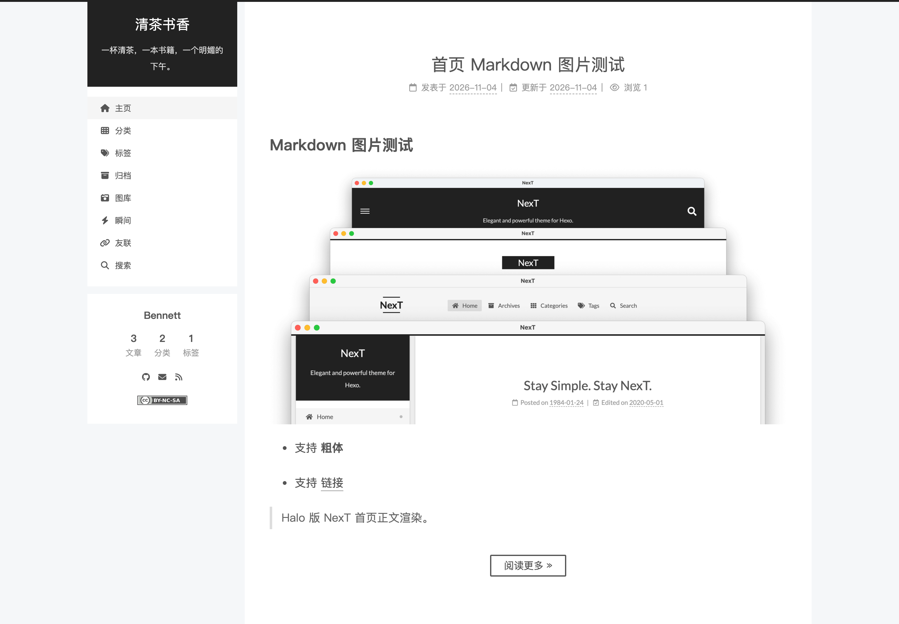

<div align="center">

# NexT

**为 Halo 2 重写的经典 NexT 主题。**

延续 hexo-theme-next 克制的排版、清晰的层次与安静的阅读体验，
同时接入 Halo 的菜单、评论与插件生态。

[](https://halo.run)
[](./theme.yaml)
[](./LICENSE)
[](https://github.com/BennettChina/halo-theme-next)

[功能特性](#-功能特性) · [安装](#-安装) · [主题设置](#-主题设置) · [插件支持](#-插件支持) · [常见问题](#-常见问题)

</div>

---

## ✨ 功能特性

- 🎨 **四套经典布局** —— 支持 Muse、Mist、Pisces、Gemini，随时切换你喜欢的侧栏与页面结构
- 🌓 **明暗模式** —— 支持浅色与暗色样式，并可跟随系统 `prefers-color-scheme` 自动切换
- ✍️ **舒适的阅读体验** —— 文章目录、阅读进度、字数与阅读时长估算、上一篇/下一篇、相关文章
- 🖼️ **完整的内容支持** —— 首页正文开头摘要、代码块复制与折叠、图片点击放大、原生分享
- 🧭 **灵活的侧栏** —— 左右侧栏、头像、作者简介、站点统计、社交链接和文章目录
- 🧩 **插件友好** —— 支持 Links、Photos、Moments、Halo 官方搜索和 Shiki 等插件
- 🔗 **多级导航** —— 菜单与分类均支持多级嵌套，菜单项可使用图标选择器
- 💬 **文章互动** —— 兼容 Halo 评论组件，支持打赏、版权声明和知识共享协议
- 🔍 **SEO 支持** —— 可输出 canonical、Open Graph、Twitter Card 和文章结构化数据
- 📱 **响应式设计** —— 适配桌面、平板与移动设备

## 📸 预览

<div align="center">
  
</div>

> 预览图为 Pisces 布局、左侧栏与浅色模式。

## 🚀 安装

### 环境要求

- Halo `2.26.0` 或更高版本

### 从 GitHub Releases 安装

1. 打开 [Releases](https://github.com/BennettChina/halo-theme-next/releases) 页面，下载最新的 `theme-halo-next-x.y.z.zip`
2. 进入 Halo Console，在「主题」页面点击「安装主题」
3. 选择「本地上传」，上传下载的 ZIP 文件
4. 安装完成后启用主题，再进入主题设置完成站点配置

### 从源码构建

如果暂时没有可用的 Release 包，也可以自行构建：

```bash
git clone https://github.com/BennettChina/halo-theme-next.git
cd halo-theme-next
pnpm install --frozen-lockfile
pnpm build
```

需要 Node.js 20+ 与 pnpm 10+。构建完成后，在 Console 中上传 `dist/` 目录下生成的主题 ZIP。

> 通过源码或手动解压部署时，主题目录名必须为 `theme-halo-next`。

### 升级与卸载

**升级**

1. 备份当前主题设置和站点数据
2. 在 Console → 主题 → 安装主题中上传新版本 ZIP，覆盖安装
3. 重新加载主题，并检查菜单、侧栏、暗色模式和插件入口

**卸载**

1. 先将站点切换到其他可用主题
2. 在 Console → 主题中卸载 NexT

卸载主题不会删除文章、页面、评论、菜单、图库、瞬间或友链等数据，这些内容由 Halo 和对应插件管理。

## ⚙️ 主题设置

启用主题后，进入 **Console → 主题 → NexT → 设置**。主题设置按以下分组组织：

| 分组       | 可以配置                                                           |
| ---------- | ------------------------------------------------------------------ |
| 基础设置   | 站点标题与副标题、布局方案、暗黑模式、LOGO、知识共享协议           |
| 侧栏设置   | 显示方式与位置、头像、作者信息、站点统计、社交链接、文章目录       |
| 页脚设置   | 版权信息、建站时间、ICP 备案、公安备案                             |
| 文章设置   | 首页文章样式、元数据、分享、标签云、打赏、相关文章、字数与阅读时长 |
| 其他设置   | 主题色、入场动画、代码块、阅读进度条、返回顶部、图片放大、SEO      |
| 第三方插件 | Halo 官方搜索插件入口                                              |

### 菜单与页面入口

主题不单独维护一套菜单，所有导航都来自 Halo 菜单。

1. 在 **Console → 菜单** 中创建菜单项
2. 在菜单列表中点击 **设置为主菜单**
3. 菜单支持多级嵌套，菜单项可在编辑时设置图标，主题会自动展示主菜单

图库、瞬间、友链等入口需要先安装对应插件，再在菜单中添加路径：

| 页面 | 路径          | 依赖         |
| ---- | ------------- | ------------ |
| 归档 | `/archives`   | Halo 内置    |
| 分类 | `/categories` | Halo 内置    |
| 标签 | `/tags`       | Halo 内置    |
| 图库 | `/photos`     | Photos 插件  |
| 瞬间 | `/moments`    | Moments 插件 |
| 友链 | `/links`      | Links 插件   |

### 文章级设置

编辑文章时，可以在文章扩展设置中单独调整当前文章：

| 扩展项                  | 作用                            |
| ----------------------- | ------------------------------- |
| 是否显示侧边栏 - Next   | 单独隐藏当前文章的侧栏          |
| 是否显示版权声明 - Next | 单独关闭当前文章的版权声明      |
| direction - Next        | 设为 `rtl` 时，正文从右到左排版 |

## 🧩 插件支持

安装并启用对应插件后，主题会自动接管相关页面和入口。

| 功能   | 支持内容             | 使用方式                                                                                 |
| ------ | -------------------- | ---------------------------------------------------------------------------------------- |
| 友链   | 友链展示、友链申请   | [Links](https://github.com/halo-sigs/plugin-links) 插件，安装后在菜单添加 `/links`       |
| 图库   | 图库列表、照片详情   | [Photos](https://github.com/halo-sigs/plugin-photos) 插件，安装后在菜单添加 `/photos`    |
| 瞬间   | 瞬间列表、瞬间详情   | [Moments](https://github.com/halo-sigs/plugin-moments) 插件，安装后在菜单添加 `/moments` |
| 搜索   | 顶部搜索入口         | Halo 官方搜索插件，安装后在主题设置中开启                                                |
| 代码块 | 代码高亮、复制、折叠 | Shiki 插件，安装后自动接管代码块渲染                                                     |
| 评论   | 文章评论             | Halo 内置评论组件，在 Halo 中开启评论并允许文章评论                                      |

友链申请由 Links 插件控制。在 **Console → 插件 → 链接管理 → 设置 → 友链申请** 中同时开启“启用友链申请”和“允许访客提交”后，`/links` 页面会自动显示申请表单，包含验证码与后台审核。

安装 Halo 官方搜索插件并在 **主题设置 → 第三方插件 → 搜索插件** 中开启后，顶部菜单会自动出现搜索入口。

已安装 Shiki 插件时，代码块由插件负责高亮、复制和折叠；主题中的代码块设置仅用于未经 Shiki 处理的代码块。

如果已使用灯箱类插件，可以在 **其他设置 → 图片放大** 中关闭主题自带的图片放大功能，避免效果重复。

## ❓ 常见问题

**启用后页面空白或样式没有生效？**

确认主题已经启用。如果通过源码或手动解压部署，请确认已执行构建、主题目录名为 `theme-halo-next`，并在 Halo Console 中重新加载主题。

**图库、瞬间或友链页面 404？**

先安装并启用对应的 Photos、Moments 或 Links 插件，再在 Halo 菜单中添加 `/photos`、`/moments` 或 `/links`。

**顶部没有搜索入口？**

确认已安装 Halo 官方搜索插件，并在 **主题设置 → 第三方插件 → 搜索插件** 中开启，同时确认 Halo 已设置主菜单。

**文章页不显示评论？**

请在 Halo 中确认评论功能已开启，并检查当前文章是否允许评论。

**图标、动画或版权徽章不显示？**

这些资源已经随主题打包，不依赖外部 CDN。如果仍不显示，请确认主题包完整，并在 Halo Console 中重新加载主题。

## 🔒 隐私与外部资源

主题本身不包含遥测、广告、统计上报或远程配置，不主动收集站点数据。字数、阅读时长和阅读进度均在浏览器本地计算。

Font Awesome、animate.css、anime.js 和 Creative Commons 许可证图标均已随主题本地打包，页面加载不需要请求第三方 CDN。评论、搜索、图库、瞬间和友链数据由对应的 Halo 插件处理；文章中的外部链接和第三方插件资源仍遵循各自的隐私说明。

## 📄 许可证与致谢

本项目采用 [AGPL-3.0-only](./LICENSE) 许可证。

主题的视觉、部分模板思路和资产来自 [hexo-theme-next](https://github.com/next-theme/hexo-theme-next)，同样使用 `AGPL-3.0-only` 许可证。根据上游许可要求，需要保留页脚 [NexT 官网](https://theme-next.js.org) 链接和上游版权署名。

本项目是针对 Halo 2 的独立适配实现，并非 NexT 官方项目，也未获得 NexT 团队背书。

- 上游项目：[next-theme/hexo-theme-next](https://github.com/next-theme/hexo-theme-next)
- 上游许可证与作者：[LICENSE-NEXT.md](./LICENSE-NEXT.md)、[AUTHORS-NEXT.md](./AUTHORS-NEXT.md)
- 上游来源与资产说明：[docs/UPSTREAM.md](./docs/UPSTREAM.md)
- 建站工具：[Halo](https://halo.run)

## 💬 反馈与建议

遇到问题或有功能建议，欢迎提交 [GitHub Issue](https://github.com/BennettChina/halo-theme-next/issues)。

反馈时请附上 Halo 版本、主题版本、布局方案、侧栏位置、浏览器和复现步骤，方便快速定位问题。

---

<div align="center">

如果这个主题对你有帮助，欢迎给一个 Star ⭐

Made with ❤️ by [Bennett](https://github.com/BennettChina)

</div>
